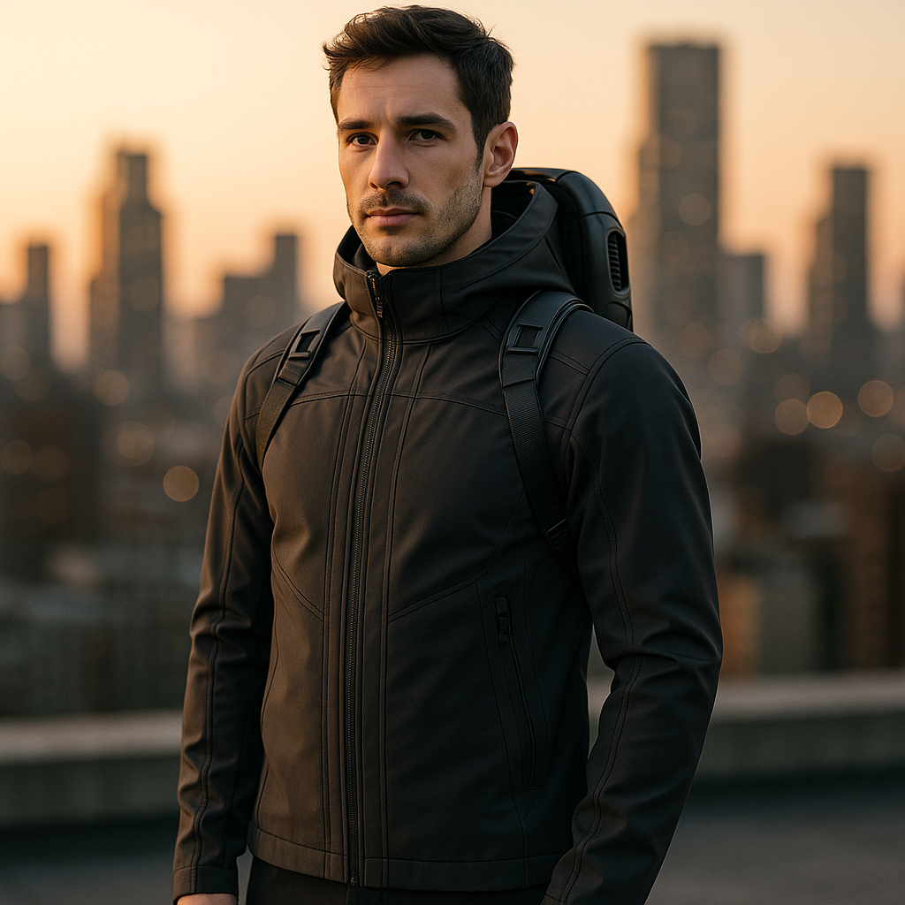
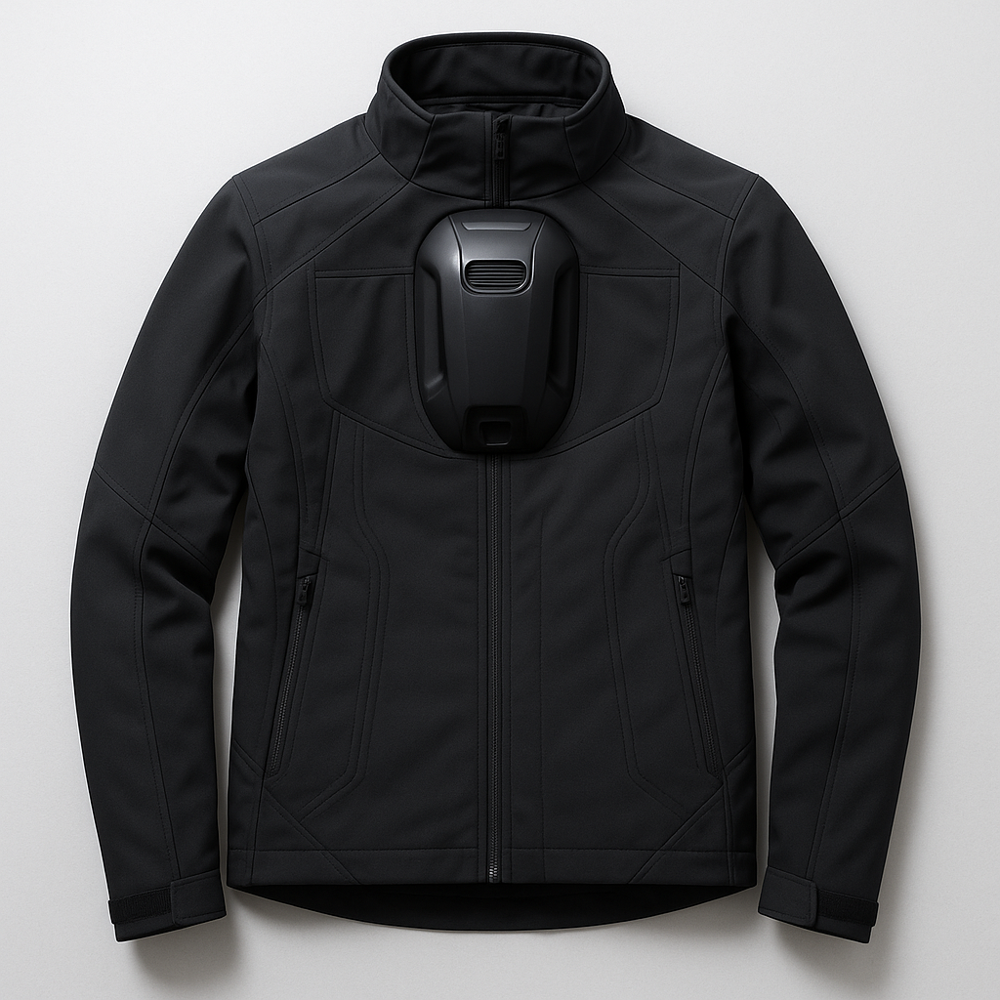

**Chill or Heat at 1,000 Feet with JetJacket: The Temperature-Controlled Jetpack Jacket**

  

**Product Description:**
Unleash the future of adventure with the JetJacket—a pioneering blend of style and innovation that takes you sky-high and keeps you comfortably grounded. Imagine soaring above the landscape with unnerving precision and ease. Our integrated compact jetpack module offers unrivaled mobility, transforming short commutes and explorations into exhilarating experiences. 

Whether you're braving the arctic chill or the scorching desert, our active temperature control system ensures you're enveloped in perfect comfort at every altitude. Crisscross through climates without missing a beat—this jacket adapts, just like you do. With an emphasis on safety, our advanced technology harmonizes stability and speed, granting peace of mind as you embrace every journey.

Dare to defy gravity and redefine limits with JetJacket. Experience the liberation of unchained horizons and unmatched comfort. Your next extraordinary adventure begins here. Make it yours today.

**Features:**
- **Jetpack Integration**: Experience unparalleled freedom with a state-of-the-art compact jetpack module designed seamlessly into the jacket, providing safe and efficient personal flight capability for short-distance travel.

- **Active Temperature Control**: Enjoy optimal comfort in diverse environments with advanced temperature regulation technology that automatically adjusts to external conditions, keeping you warm in the cold and cool in the heat.

- **Innovative Safety Features**: Prioritize your safety with integrated safety mechanisms including an emergency shutdown system and stabilization controls to ensure a secure flight experience.

- **Sleek, Modern Design**: Flaunt a sleek, aerodynamic design that is both stylish and functional, crafted using high-quality materials that align with the latest fashion trends while maximizing performance.

- **Ultimate Comfort**: Experience all-day comfort with a lightweight, ergonomic design that enables effortless mobility, ensuring that the jacket feels like a natural extension of your body.

- **Enhanced Performance**: Boost your performance with a jacket that leverages cutting-edge technology to amplify your physical capabilities, from enhancing speed and efficiency in flight to maintaining comfort on the ground.

- **Eco-Friendly Materials**: Commit to sustainability with eco-conscious materials and manufacturing processes, minimizing environmental impact without compromising quality or functionality.

**Customer Testimonials:**
_"As someone who weaves through city traffic daily, this tech jacket has transformed my morning routine. The jetpack module provides just the right boost to glide over congested streets, while the active temperature control keeps me cozy no matter the weather. It’s the sleek, stylish edge I never knew I needed!"_

_"I'm an avid hiker, and this jacket has elevated my adventures to the next level. Tackling steep inclines has never been easier with the jetpack module giving me that extra lift when I need it. And no more over-packing for unpredictable weather – the temperature control keeps my focus on the path ahead."_

_"As a full-time student juggling classes across campus, this jacket is my new favorite tool. Running late to lectures? The jetpack is a lifesaver! And whether I'm walking in rain or shine, the climate control feature is a blessing. It's functional, 100% unique, and definitely a conversation starter!"_